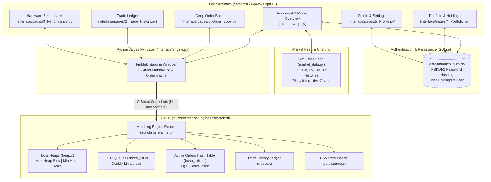

# FinMatch — High-Performance Stock Trading Simulator
> **A Modern, Premium Stock Trading Simulator inspired by Groww's Clean Light UI, powered by a C11 Ultra-Low Latency Matching Engine, SQLite Authentication, and Python Streamlit Frontend.**

[](https://en.cppreference.com/w/c/11)
[]()
[]()
[]()
[]()

---

## 📌 1. Project Overview

**FinMatch** is a modern, responsive, and premium simulated electronic stock exchange terminal. It pairs an ultra-low latency, deterministic limit order book matching engine written in modern C (C11) with a Groww-inspired light theme trading frontend built with Streamlit, Plotly, and SQLite.

The matching engine enforces **strict Price-Time Priority (FIFO at price)** through an advanced hybrid memory architecture:
- **Dual Heaps / Priority Queues**: Max-Heap for Bids (highest price priority) and Min-Heap for Asks (lowest price priority) with $O(1)$ best-bid/best-ask peek.
- **Doubly Linked FIFO Queues**: Guarantees arrival-order fairness for orders at the same price level with $O(1)$ head pop and arbitrary node deletion.
- **Separate Chaining Hash Table**: $O(1)$ average order lookup and cancellation by unique 64-bit ID without scanning the book.
- **Persistent Simulated Feed & Dynamic Charts**: 1D, 1W, 1M, 3M, and 1Y interactive Plotly line and candlestick charts with volume bars, green/red price indicators, and unified state with the C matching engine.
- **Database-Backed Authentication & Accounts**: SQLite database with salted PBKDF2-HMAC-SHA256 password hashing, user data isolation, virtual cash balances, portfolio tracking, and session persistence.

> [!IMPORTANT]
> **Educational Simulator Disclaimer**: FinMatch is a paper-trading simulation platform designed for financial computing and Data Structures & Algorithms coursework. It does **not** process real money or connect to live exchange feeds. All prices, trades, and market histories are simulated.

---

## 🎨 2. Design System (Groww-Inspired Light Theme)

The UI has been redesigned to reflect Groww's clean, modern, and uncluttered light visual identity:
- **Clean Light Palette**: `#FFFFFF` card surfaces, subtle `#F8FAFC` page background, and crisp dark typography (`#0F172A`, `#1E293B`, `#64748B`).
- **Brand Accents**: Groww emerald green (`#00D09C`) for gains and positive movements; coral red (`#EB5B3C`) for losses and downward price movements.
- **Modern Typography & Spacing**: Clean fonts, rounded card corners (`border-radius: 12px`), thin borders (`#E5E7EB`), and soft shadows.
- **Groww-Style Buy & Sell Panels**: Emerald Green tab for BUY orders, Coral Red tab for SELL orders, with instant order value estimation, cash margin validation, and duplicate submission prevention.
- **Polished Interactive Charts**: Smooth gradient-filled line charts and full candlestick charts with volume bars, hover crosshairs, and timeframe selectors (`1D`, `1W`, `1M`, `3M`, `1Y`).

---

## 🏗️ 3. Architecture & Data Flow



---

## 📁 4. Repository Structure

```text
FinMatch/
├── core/
│   ├── include/
│   │   ├── order.h            # Order struct, enums, integer paise prices, validation
│   │   ├── order_book.h       # Dual-heap order book per stock symbol
│   │   ├── heap.h             # Min/Max Priority Queue for price levels
│   │   ├── linked_list.h      # Doubly-linked FIFO queue for same-price orders
│   │   ├── hash_table.h       # Chained hash table for O(1) order lookup & cancel
│   │   ├── matching_engine.h  # Price-time priority matching engine
│   │   ├── trades.h           # Execution trade records & volume analytics
│   │   ├── persistence.h      # CSV export and engine state restore
│   │   └── finmatch_api.h     # Exported C API & snapshot structs for ctypes
│   ├── src/
│   │   ├── main.c             # Standalone C CLI demo
│   │   ├── order.c            # Order validation, creation, state machine
│   │   ├── order_book.c       # Symbol book management & depth snapshots
│   │   ├── heap.c             # Sift-up, sift-down, arbitrary level deletion
│   │   ├── linked_list.c      # FIFO queue append tail, pop head, O(1) removal
│   │   ├── hash_table.c       # 64-bit hashing, bucket chaining, auto-growth
│   │   ├── matching_engine.c  # Core limit matching logic & cross-order execution
│   │   ├── trades.c           # Completed trade history & turnover aggregates
│   │   ├── persistence.c      # CSV serialization & order book re-hydration
│   │   └── finmatch_api.c     # Exported shared library entrypoints
│   └── Makefile               # MinGW-w64 build configuration
├── interface/
│   ├── app.py                 # Main Streamlit Dashboard (Groww Light UI)
│   ├── engine.py              # Python ctypes wrapper & C-struct mappings
│   ├── style.py               # Groww light theme CSS & UI components
│   ├── auth.py                # SQLite authentication, PBKDF2 hashing, portfolio DB
│   ├── market_data.py         # Simulated market feed & Groww Plotly charts
│   ├── requirements.txt       # Dependencies (streamlit, pandas, plotly)
│   └── pages/
│       ├── 1_Order_Book.py    # Dual-heap order book depth & cumulative curve
│       ├── 2_Trade_History.py # Executed trade audit log & CSV exporter
│       ├── 3_Performance.py   # Hardware latency distribution & DSA complexity
│       ├── 4_Portfolio.py     # Holdings breakdown, P&L, allocation donut chart
│       └── 5_Profile.py       # Account settings, virtual cash faucet, reset
├── tests/
│   ├── integration_check.py   # Python-to-C FFI end-to-end integration check
│   ├── test_redesign_suite.py # Automated test suite for Auth, Market, & Trading
│   ├── test_matching.c        # C unit tests for order matching rules
│   ├── test_orders.c          # C unit tests for validation, heap, and hash table
│   ├── test_edge_cases.c      # Cancellation, empty books, multi-symbol tests
│   └── Makefile               # C unit test build script
├── benchmarks/
│   ├── benchmark.c            # Monotonic hardware timer benchmark executable
│   ├── README.md              # Benchmark methodology & execution guide
│   └── last_benchmark.json    # Latest benchmark output for Streamlit dashboard
├── data/
│   ├── finmatch_auth.db       # SQLite database for users, holdings, and orders
│   └── .gitkeep               # Directory for exported orders and trades CSVs
├── build.ps1                  # PowerShell one-click build & test runner
├── build.bat                  # Windows batch build script
├── finmatch.dll               # 64-bit compiled shared library
├── finmatch.exe               # Standalone C CLI executable
├── README.md                  # Comprehensive project documentation
└── .streamlit/
    └── config.toml            # Streamlit native light theme configuration
```

---

## ⚡ 5. Matching Engine DSA Complexity

| Operation | FinMatch DSA Architecture | Naive Array | Balanced BST (AVL / RB) |
| :--- | :--- | :--- | :--- |
| **Peek Best Price** | **$O(1)$** (Heap Root) | $O(N)$ (Linear Scan) | $O(\log P)$ (Min/Max Traversal) |
| **Insert New Price Level** | **$O(\log P)$** (Heap Push) | $O(P)$ (Array Shift) | $O(\log P)$ (Tree Insertion) |
| **Insert Order at Level** | **$O(1)$** (Queue Push Tail) | $O(N)$ (Search & Shift) | $O(\log P)$ (Search + Push) |
| **Execute Match at Head** | **$O(1)$** (Queue Pop Head) | $O(N)$ (Array Shift) | $O(1)$ (Queue Pop Head) |
| **Cancel Order by ID** | **$O(1)$** (Hash Lookup + Node Delete) | $O(N)$ (Linear Search) | $O(\log N)$ (Tree Search) |
| **Prune Empty Level** | **$O(\log P)$** (Heap Remove via Index) | $O(P)$ (Array Shift) | $O(\log P)$ (Tree Node Deletion) |
| **Active Order Lookup** | **$O(1)$** (Hash Table Lookup) | $O(N)$ (Linear Search) | $O(\log N)$ (Tree Search) |

*Where $N$ is total orders in the engine, and $P$ is the number of distinct price levels ($P \ll N$).*

---

## 💻 6. Installation & Launch Instructions

### Prerequisites
- **OS**: Windows 10 or 11 (64-bit)
- **Python**: Python 3.10+ (64-bit)
- **C Compiler (Optional for re-building)**: MinGW-w64 GCC (precompiled `finmatch.dll` is already included in the repository)

### 1. Install Python Dependencies
```powershell
pip install -r interface/requirements.txt
```

### 2. Launch the Trading Simulator
```powershell
python -m streamlit run interface/app.py
```
Open your browser to `http://localhost:8501`.

### 3. Demo Credentials
The simulator includes a pre-seeded practice account with ₹10,00,000 virtual balance and sample holdings:
- **Email:** `demo@groww.in`
- **Password:** `groww123`
*(Or click the **⚡ Fast Demo Log In (1-Click)** button on the login screen to enter immediately without typing credentials).*

---

## 🧪 7. Automated Test Suites

FinMatch includes multi-tier automated test coverage:

### A. Python Integration & Redesign Test Suites
```powershell
# 1. Run Python-to-C FFI integration check
python tests/integration_check.py

# 2. Run Redesign Auth, Market Feed, and Portfolio test suite
python tests/test_redesign_suite.py
```

### B. C11 Engine Unit & Regression Tests (154 Assertions)
```powershell
.\tests\test_orders.exe
.\tests\test_matching.exe
.\tests\test_edge_cases.exe
```

### C. Real-Time Hardware Benchmark
```powershell
.\benchmarks\benchmark.exe 50000
```

---

## 📊 8. Verified Performance Benchmarks

Measured on a standard x86_64 Windows host running GCC `-O3` with monotonic hardware timers:

```text
====================================================================
                     BENCHMARK RESULTS SUMMARY                      
====================================================================
  Total Operations Processed:  50,000
  Total Benchmark Duration:    0.0276 seconds
  Throughput:                  1,809,863.03 orders/sec
  Trades Executed:             34,053
  Total Traded Shares:         1,883,690
  Total Turnover (INR):        ₹4,287,272,287.50
  Remaining Active Orders:     8,156
  Successful Cancellations:    1,038
--------------------------------------------------------------------
  LATENCY DISTRIBUTION (Microseconds per Operation):
    Min Latency:                   0.00 µs
    Average Latency:               0.51 µs  (510 nanoseconds)
    Median (50th percentile):      0.40 µs  (400 nanoseconds)
    90th Percentile:               0.70 µs  (700 nanoseconds)
    95th Percentile:               0.80 µs  (800 nanoseconds)
    99th Percentile:               1.20 µs
    Max Latency:                 682.80 µs
====================================================================
```

---

## 🔒 9. Security & Account Isolation Practices
- **Password Hashing**: PBKDF2-HMAC-SHA256 with 100,000 rounds and unique 16-byte random salts per user. Plaintext passwords are never stored.
- **Timing Attack Mitigation**: Secret comparisons use constant-time `secrets.compare_digest`.
- **User Data Isolation**: User holdings, cash balances, and order histories are strictly partitioned by `user_id` foreign keys in SQLite.
- **Form Idempotency**: Order submissions use per-submission request tokens to prevent duplicate order placement on Streamlit reruns.
