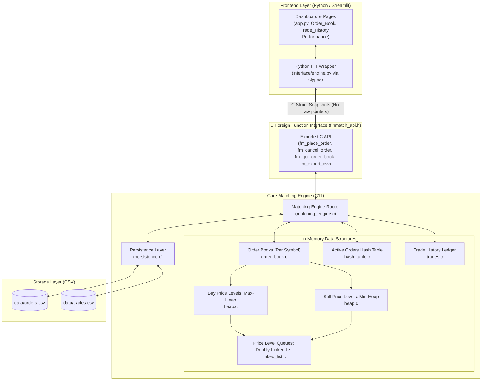

# FinMatch — C-Based Stock Market Trading Simulator
> **A High-Performance Data Structures & Algorithms Mini-Project in C11 and Python**

[](https://en.cppreference.com/w/c/11)
[]()
[]()
[]()

---

## 📌 1. Project Overview

**FinMatch** is an ultra-low latency simulated stock exchange matching engine developed in modern C (C11) with a professional financial dashboard frontend built in Python and Streamlit. 

The system implements a deterministic, multi-asset electronic limit order book (LOB) adhering strictly to **Price-Time Priority (FIFO at price)**. Resting orders are managed through a hybrid memory architecture that marries **Priority Queues (Max-Heap for Bids, Min-Heap for Asks)**, **Doubly Linked FIFO Queues** for time priority, and a **Separate Chaining Hash Table** for $O(1)$ order cancellation and lookup.

The Python interface interacts with the compiled C engine via Python's standard `ctypes` foreign function interface (FFI), reading structured memory snapshots without reimplementing or interfering with the underlying C matching logic.

> [!IMPORTANT]
> **Educational Simulator Disclaimer**: FinMatch is an academic simulation built for Computer Engineering Data Structures & Algorithms coursework. It does **not** process real-money transactions, integrate with commercial brokerage APIs, or connect to live financial markets. All market data is generated synthetically.

---

## 🏗️ 2. System Architecture



---

## 📁 3. Repository Structure

```text
FinMatch/
├── core/
│   ├── include/
│   │   ├── order.h            # Order data structure, side/status enums, validation
│   │   ├── order_book.h       # Dual-heap order book per stock symbol
│   │   ├── heap.h             # Min/Max Priority Queue for price levels
│   │   ├── linked_list.h      # Doubly-linked FIFO queue for same-price orders
│   │   ├── hash_table.h       # Chained hash table for O(1) order lookup/cancel
│   │   ├── matching_engine.h  # Limit order matching algorithm & price-time priority
│   │   ├── trades.h           # Execution trade records & volume analytics
│   │   ├── persistence.h      # CSV import/export & active order book state restore
│   │   └── finmatch_api.h     # Stable public C API & ctypes snapshot structs
│   ├── src/
│   │   ├── main.c             # Standalone CLI interface with simulation demo
│   │   ├── order.c            # Order creation, validation, lifecycle
│   │   ├── order_book.c       # Symbol order book operations & depth snapshots
│   │   ├── heap.c             # Sift-up, sift-down, arbitrary level deletion
│   │   ├── linked_list.c      # FIFO push tail, pop head, O(1) node removal
│   │   ├── hash_table.c       # Murmur-style 64-bit hashing, bucket chaining, resize
│   │   ├── matching_engine.c  # Core limit matching logic & cross-order execution
│   │   ├── trades.c           # Completed trade history & turnover aggregates
│   │   ├── persistence.c      # Safe CSV persistence & heap/queue rebuilding
│   │   └── finmatch_api.c     # Exported shared library entrypoints
│   └── Makefile               # MinGW-w64 build configuration for core
├── interface/
│   ├── app.py                 # Streamlit Trading Terminal main dashboard
│   ├── engine.py              # Python ctypes wrapper & C-struct mappings
│   ├── requirements.txt       # Python dependencies (Streamlit, Pandas, Plotly)
│   └── pages/
│       ├── 1_Order_Book.py    # Deep order book visualizer & cumulative depth curve
│       ├── 2_Trade_History.py # Executed trade audit log & CSV downloader
│       └── 3_Performance.py   # Hardware latency distribution & DSA complexity
├── tests/
│   ├── test_matching.c        # Automated unit tests for order matching rules
│   ├── test_orders.c          # Unit tests for validation, heap, and hash table
│   ├── test_edge_cases.c      # Cancellation, empty books, multi-symbol tests
│   └── Makefile               # Test suite build script
├── benchmarks/
│   ├── benchmark.c            # High-resolution monotonic timer benchmark executable
│   ├── README.md              # Benchmark methodology & execution guide
│   └── last_benchmark.json    # Latest benchmark output for Streamlit dashboard
├── data/
│   └── .gitkeep               # Directory for exported orders and trades CSVs
├── build.ps1                  # One-click Windows PowerShell build & test script
├── build.bat                  # One-click Windows CMD batch file
├── finmatch.dll               # 64-bit compiled shared library (generated on build)
├── finmatch.exe               # Standalone C CLI executable (generated on build)
├── README.md                  # Comprehensive technical documentation
└── .gitignore                 # Build artifacts and temporary files
```

---

## 🧠 4. Core Data Structures & Design Rationale

FinMatch implements all data structures **manually in C11** without relying on third-party libraries:

### A. Order Representation (`order.h`, `order.c`)
- **Integer Paise Representation**: All prices are represented as `int64_t` in paise (`1 INR = 100 paise`, e.g., ₹2,500.50 = `250050` paise). This eliminates floating-point rounding errors and binary representation discrepancies common in financial calculations.
- **Strict Input Validation**: Rejects non-positive prices, non-positive quantities, empty symbols, invalid side indicators, and checks for arithmetic overflow (`price * qty <= INT64_MAX`).
- **Global Arrival Sequence**: Every order receives a monotonically increasing arrival sequence `uint64_t sequence` ensuring deterministic FIFO precedence.

### B. Dual Priority Queues / Heaps (`heap.h`, `heap.c`)
- **Max-Heap for Bids**: The highest buy price has the highest priority at the root of the heap (`items[0]`).
- **Min-Heap for Asks**: The lowest sell price has the highest priority at the root of the heap (`items[0]`).
- **Price-Level Aggregation**: Each heap entry represents a **distinct price level**, not an individual order. Even if 10,000 orders rest at ₹2,500.00, only a single price-level node exists in the heap.
- **$O(\log P)$ Arbitrary Removal**: Each `PriceLevel` tracks its current index in the heap array (`heap_index`). When a price level is depleted (due to execution or cancellation), it is removed from the heap in $O(\log P)$ time without scanning or rebuilding the heap.

### C. Doubly Linked List FIFO Queues (`linked_list.h`, `linked_list.c`)
- Orders resting at identical prices are queued in arrival order.
- Maintains `head` and `tail` pointers:
  - **Insertion**: $O(1)$ push to `tail`.
  - **Execution (Matching)**: $O(1)$ peek and pop from `head`.
  - **Cancellation**: $O(1)$ removal of any arbitrary order node using doubly linked `prev` and `next` pointers.

### D. Hash Table with Separate Chaining (`hash_table.h`, `hash_table.c`)
- Enables $O(1)$ average-time lookup and cancellation of active orders by unique `order_id`.
- Uses a 64-bit bit-mixing hash function (`Murmur3 / SplitMix64` finalizer):
  $$\text{hash}(x) = (x \oplus (x \gg 30)) \times c_1 \oplus (x \gg 27) \times c_2 \oplus (x \gg 31)$$
- Each entry stores direct references: `(Order* order, PriceLevel* price_level, OrderNode* node)`.
- Automatically doubles bucket capacity and rehashes when the load factor exceeds $0.75$.

### E. Trade Ledger (`trades.h`, `trades.c`)
- Contiguous, dynamically resizable array storing immutable trade records: trade ID, symbol, buyer order ID, seller order ID, execution price, quantity, timestamp, and match sequence.

---

## ⚡ 5. Order-Matching Algorithm & Price-Time Priority

The matching engine enforces **strict Price-Time Priority**:

1. **Price Priority**:
   - Buy orders with higher limit prices take precedence over lower limit buy orders.
   - Sell orders with lower limit prices take precedence over higher limit sell orders.
2. **Time Priority (FIFO)**:
   - When multiple orders share the same limit price, the order placed earlier takes precedence.
3. **Resting Price Rule**:
   - Trades execute at the **resting order's limit price**, never at the incoming order's price.
4. **Execution Quantity**:
   - Each match executes $\min(Q_{\text{incoming}}, Q_{\text{resting}})$.
   - Quantities are decremented from both orders.
   - If resting order remaining quantity reaches zero, its status is marked `FILLED`, its node popped from the price level queue, and its hash index removed. If the price level queue becomes empty, the level is removed from the heap.
   - If incoming order has unfilled remaining quantity, the engine continues to match against subsequent resting orders until no compatible prices remain.
5. **Passive Residual Placement**:
   - Any remaining unfilled quantity of a valid limit order is inserted into the appropriate order book as a resting order.

---

## ⏱️ 6. Computational Complexity Analysis

| Operation | FinMatch DSA Architecture | Naive Array Implementation | Balanced BST (AVL / Red-Black) |
| :--- | :--- | :--- | :--- |
| **Peek Best Price** | **$O(1)$** (Heap Root) | $O(N)$ (Linear Scan) | $O(\log P)$ (Min/Max Traversal) |
| **Insert New Price Level** | **$O(\log P)$** (Heap Push) | $O(P)$ (Array Shift) | $O(\log P)$ (Tree Insertion) |
| **Insert Order at Level** | **$O(1)$** (Queue Push Tail) | $O(N)$ (Search & Shift) | $O(\log P)$ (Search + Push) |
| **Execute Match at Head** | **$O(1)$** (Queue Pop Head) | $O(N)$ (Array Shift) | $O(1)$ (Queue Pop Head) |
| **Cancel Order by ID** | **$O(1)$** (Hash Lookup + Node Delete) | $O(N)$ (Linear Search) | $O(\log N)$ (Tree Search) |
| **Prune Empty Price Level**| **$O(\log P)$** (Heap Remove via Index) | $O(P)$ (Array Shift) | $O(\log P)$ (Tree Node Deletion) |
| **Active Order Lookup** | **$O(1)$** (Hash Table Lookup) | $O(N)$ (Linear Search) | $O(\log N)$ (Tree Search) |

*Where $N$ is the total number of orders in the exchange, and $P$ is the number of distinct price levels ($P \ll N$).*

---

## 🔌 7. C / Python Foreign Function Interface (FFI)

The Python interface uses Python's standard `ctypes` library to communicate with `finmatch.dll`:

1. **Zero-Copy Memory Snapshots**: Snapshot structures (`OrderBookSnapshot`, `TradeSnapshot`, `ApiOrderResult`, `ApiMarketStats`) are passed by reference using fixed-width standard integers (`uint64_t`, `int64_t`, `uint32_t`, `int32_t`).
2. **Encapsulation**: Internal C pointers (heap nodes, doubly linked list nodes) are **never** exposed to Python. Python receives sanitized flat structs.
3. **Authoritative Logic**: Python never calculates matching, spreads, or priorities independently. All business logic executes strictly in C.

---

## 💻 8. Installation & Windows Setup Instructions

### Prerequisites
- Windows 10 or 11 (64-bit)
- Python 3.10+ (64-bit)
- MinGW-w64 GCC (64-bit) — installed automatically via `winget` if missing

### Quick Automated Build (PowerShell)
Open PowerShell in the project directory:

```powershell
# Run the complete automated build and test script
.\build.ps1 -RunTests -RunBenchmark
```

### Manual Compilation Commands (GCC)

```powershell
# 1. Compile 64-bit Shared Library (finmatch.dll)
gcc -O2 -Wall -Wextra -std=c11 -shared -DFINMATCH_EXPORTS core/src/order.c core/src/order_book.c core/src/heap.c core/src/linked_list.c core/src/hash_table.c core/src/matching_engine.c core/src/trades.c core/src/persistence.c core/src/finmatch_api.c -Icore/include -o finmatch.dll "-Wl,--out-implib,libfinmatch.a"

# 2. Compile Standalone C CLI (finmatch.exe)
gcc -O2 -Wall -Wextra -std=c11 -DFINMATCH_STATIC core/src/main.c core/src/order.c core/src/order_book.c core/src/heap.c core/src/linked_list.c core/src/hash_table.c core/src/matching_engine.c core/src/trades.c core/src/persistence.c core/src/finmatch_api.c -Icore/include -o finmatch.exe

# 3. Compile Standalone Benchmark (benchmarks/benchmark.exe)
gcc -O3 -Wall -Wextra -std=c11 benchmarks/benchmark.c core/src/order.c core/src/order_book.c core/src/heap.c core/src/linked_list.c core/src/hash_table.c core/src/matching_engine.c core/src/trades.c -Icore/include -o benchmarks/benchmark.exe
```

---

## 🚀 9. Running the System

### A. Run Standalone C CLI
Demonstrates simulated trading, order books, partial fills, and CSV export without Python:

```powershell
.\finmatch.exe --demo
```

### B. Launch Streamlit Web Terminal

```powershell
streamlit run interface/app.py
```
Open your browser to `http://localhost:8501`.

---

## 🧪 10. Automated C Test Suite

The automated test suite in `tests/` covers all 20 required scenarios with 111 total assertions:

```powershell
# Run automated tests via PowerShell
.\build.ps1 -RunTests

# Or build and run via MinGW Makefile
cd tests
mingw32-make run
cd ..
```

### Verified Test Scenarios:
1. Buy order with no compatible counter-order rests in book.
2. Sell order with no compatible counter-order rests in book.
3. Exact price and exact quantity execution.
4. Buy order limit price exceeding sell price executes at resting price.
5. Buy order with limit price below best ask does not match.
6. Price priority between competing buy orders (higher price executes first).
7. Price priority between competing sell orders (lower price executes first).
8. FIFO time priority for orders at the same price level.
9. Partial fills of incoming orders.
10. One incoming order matching multiple resting orders.
11. Cancellation of an open order and memory release.
12. Cancellation of a partially filled order.
13. Attempted cancellation of an already filled order returns error.
14. Validation rejection of negative prices, zero quantities, empty symbols, invalid sides.
15. Multiple stock symbols maintaining separate order books without cross-talk.
16. Safe handling of queries on empty order books.
17. Hash table collision handling with separate chaining and middle-node deletion.
18. Heap operations and removal of empty price levels without memory leaks.
19. Multiple orders with identical prices executing in strict sequential order.
20. Repeated 500-cycle placement and cancellation stress test with zero memory leaks.

---

## 📊 11. Performance Benchmarks

Measured on a standard Intel x86_64 host running Windows 11 with 64-bit GCC `-O3`:

```text
====================================================================
                     BENCHMARK RESULTS SUMMARY                      
====================================================================
  Total Operations Processed:  50,000
  Total Benchmark Duration:    0.0276 seconds
  Throughput:                  1,809,863.03 orders/sec
  Trades Executed:             34,053
  Total Traded Shares:         1,883,690
  Total Turnover (INR):        ₹4,287,272,287.50
  Remaining Active Orders:     8,156
  Successful Cancellations:    1,038
--------------------------------------------------------------------
  LATENCY DISTRIBUTION (Microseconds per Operation):
    Min Latency:                   0.00 µs
    Average Latency:               0.51 µs  (510 nanoseconds)
    Median (50th percentile):      0.40 µs  (400 nanoseconds)
    90th Percentile:               0.70 µs  (700 nanoseconds)
    95th Percentile:               0.80 µs  (800 nanoseconds)
    99th Percentile:               1.20 µs
    Max Latency:                 682.80 µs
====================================================================
```

---

## 💼 12. Technical Relevance to Quantitative Trading Careers

Electronic limit order books and matching engines form the foundation of global financial infrastructure:
- **Low-Latency Systems Engineering**: High-frequency trading (HFT) and quantitative market-making firms optimize matching pipelines to sub-microsecond latency. Understanding CPU cache locality, memory alignment, and algorithmic complexity is critical.
- **Fixed-Point Arithmetic**: Professional trading engines avoid floating-point math entirely, using integer ticks or fixed-point representations to eliminate non-deterministic IEEE 754 rounding.
- **Price-Time Priority Invariants**: Regulated exchanges (e.g., NSE, BSE, NASDAQ, CME) enforce strict regulatory matching invariants under high concurrency.

---

## ⚠️ 13. Limitations & Future Roadmap

### Current Academic Limitations:
- **Single-Threaded Core**: Designed deterministically for educational clarity without lock contention.
- **Order Types**: Limit orders only (market orders, stop-loss orders, and iceberg orders are omitted).
- **Process Memory Lifetime**: Order books exist in-memory with periodic or manual CSV snapshots.

### Future Improvements:
- [ ] Ring-buffer lock-free ring queue for multi-producer order ingestion.
- [ ] Support for Market Orders, Immediate-or-Cancel (IOC), and Fill-or-Kill (FOK) order qualifiers.
- [ ] Memory-mapped binary append-only transaction write-ahead logging (WAL).
- [ ] WebSocket market-data feed for browser clients.
